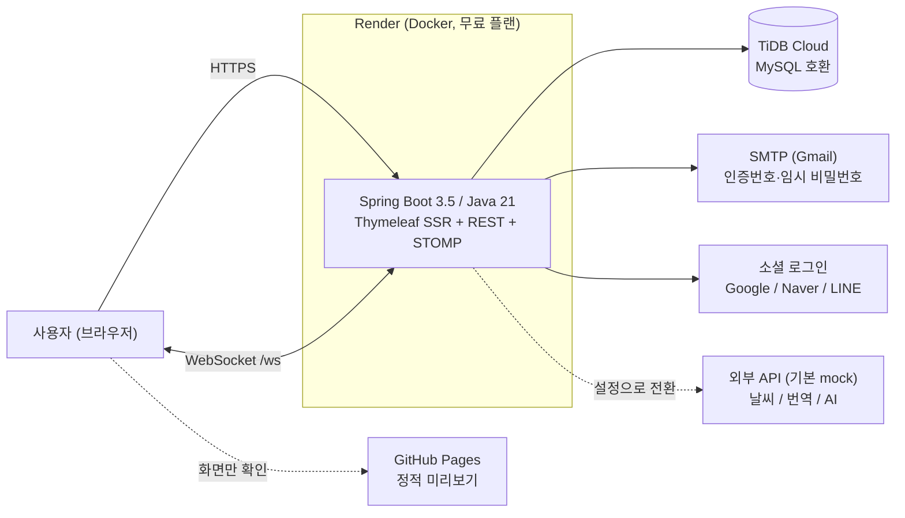
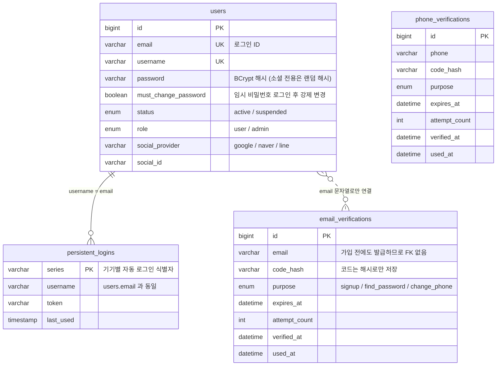
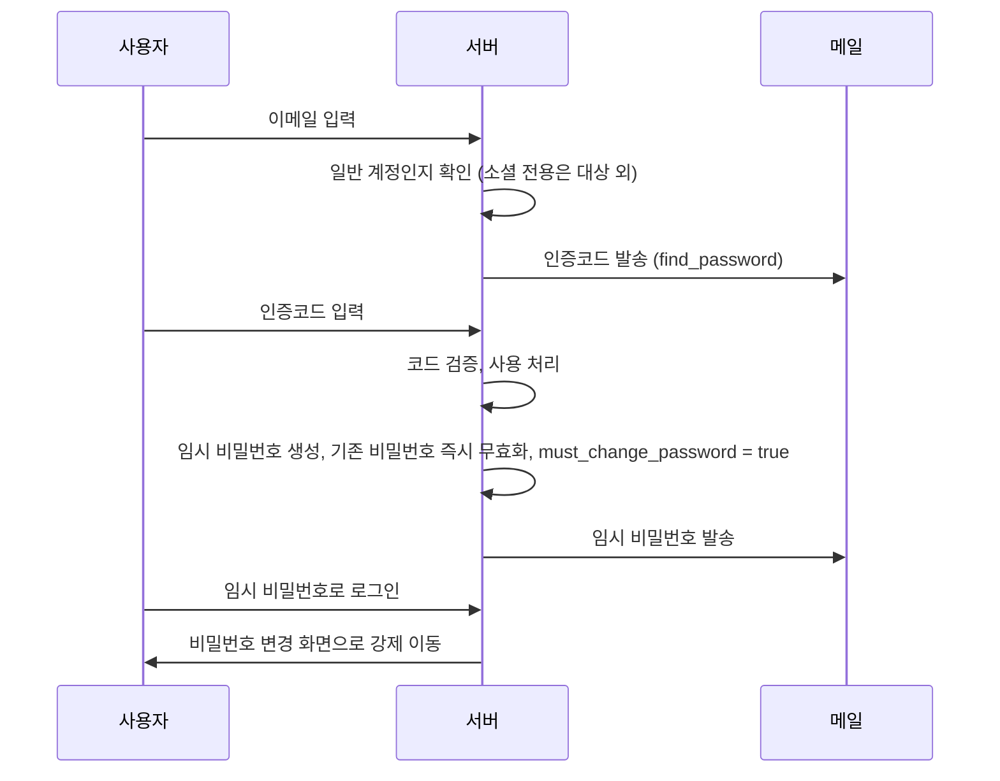
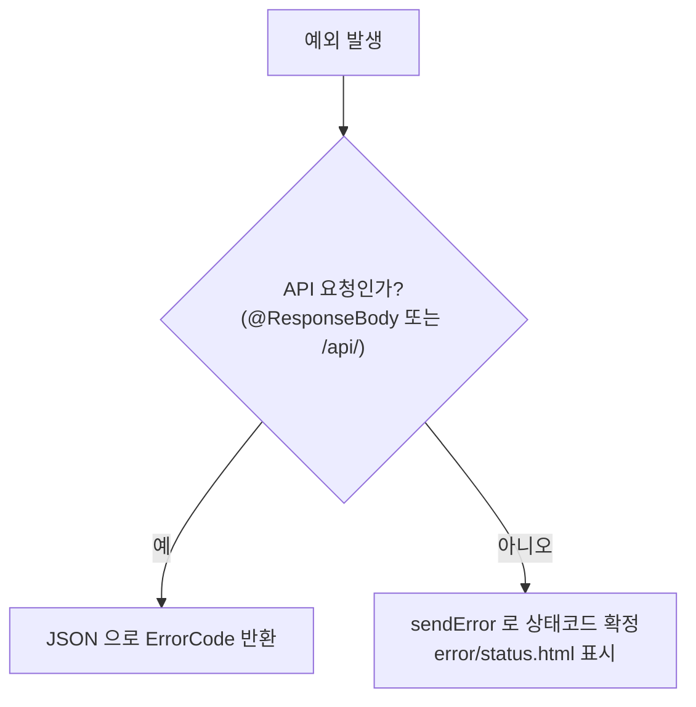

# 07. 구성도 · 인증 ER도 · 주요 플로우

GitHub 에서 Mermaid 로 렌더링된다. 문서와 코드가 다르면 **코드가 정답**이다.

## 1. 시스템 구성도

## 2. 인증 모듈 ER도

`email_verifications` 는 `users` 와 FK 로 묶지 않는다. 가입 전(아직 users 행이 없는 상태)에도 인증코드를 발급해야 하기 때문에 이메일 문자열로만 연결한다.

- `users` 의 유니크 키: `email`, `username`, `phone`, `(social_provider, social_id)`
- 소셜 계정과 일반 계정이 같은 이메일을 쓰는 경우 자동 통합하지 않고, 로그인 후 마이페이지에서 수동 연동한다.

## 3. 비밀번호 재발급 플로우

## 4. 예외 처리 분기

